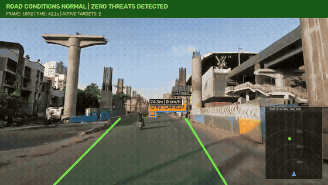

# RoadWatch AI

<div align="center">

> **Intelligent road safety and predictive driver behaviour analysis system engineered for two-wheeler commuters in high-density urban traffic.**

[](https://github.com/aryan-patil21/RoadWatchAI)
[](https://www.python.org/)
[](https://developer.apple.com/metal/)
[](https://fastapi.tiangolo.com/)
[](https://developer.apple.com/swift/)
[](LICENSE)

<br/>



*RoadWatch AI Cockpit HUD: Real-time 2D Bird's-Eye View (BEV) radar, Inverse Perspective Mapping metric distance ($Z$) and closing velocity ($\Delta Z / \Delta t$), Top-Hat asphalt stripe travel corridor, and synchronized audio warning system.*

</div>

---

## Executive Summary & Core Principle

Motorcyclists and scooter commuters in dense urban traffic environments (e.g., Pune, Mumbai) operate under constrained reaction windows when confronted with sudden lane encroachments, blind-spot merges, and hard braking by larger commercial vehicles.

RoadWatch AI evaluates traffic threats through a strict empirical kinematic paradigm, enforcing zero vehicle-type or brand bias:

$$\mathbf{Observable\ Behaviour} \longrightarrow \mathbf{Measurable\ Kinematic\ Features} \longrightarrow \mathbf{Empirical\ Risk\ Estimation} \longrightarrow \mathbf{Actionable\ Warning}$$

Threat levels are derived exclusively from physical trajectory attributes, relative velocity, and spatio-temporal clearance.

---

## Key Technical Systems

### 1. Monocular 3D Metric Projection (IPM)
Projects 2D image coordinates from vehicle ground-contact tire interfaces into real-world Cartesian metric coordinates ($X_{\text{m}}, Z_{\text{m}}$) using calibrated camera height ($1.25$ m) and horizon homography ($y = 265$ px):
$$Z = \frac{f \cdot h_{\text{cam}}}{\max(1, y_{\text{contact}} - y_{\text{horizon}})}, \quad X = \frac{(x_{\text{contact}} - c_x) \cdot Z}{f}$$

### 2. Continuous Approach Velocity & 2D Bird's-Eye View (BEV) Radar
Computes instantaneous relative closing velocity ($\Delta Z / \Delta t \times 3.6$ km/h) and Time-To-Collision proxy ($\text{TTC}$) across a rolling window. Renders a 40-meter top-down BEV radar widget tracking surrounding traffic density with dynamic threat-locking reticles.

### 3. Top-Hat Asphalt Stripe Corridor Estimation
Isolates worn road pavement stripes and physical travel boundaries using morphological Top-Hat filtering ($11 \times 1$ horizontal structuring element) combined with perspective corridor boundary clamping ($140$ px to $590$ px at the bottom plane) to prevent cross-lane bleed in unstructured traffic conditions.

### 4. Multimodal Warning Arbitration & Synchronized Audio
Implements a multi-tier finite-state debouncing machine (`SAFE` $\to$ `CAUTION` $\to$ `CRITICAL`) with cooldown timers and priority escalation overrides. Warning beeps are integrated directly into standard QuickTime-compatible H.264/AAC containers.

### 5. Automated Forensic Incident Blackbox Recorder
Maintains a 5.0-second circular in-memory buffer (`collections.deque`). Upon detection of a `CRITICAL` safety hazard, the recorder packages an isolated 10-second forensic incident clip accompanied by a structured JSON telemetry manifest capturing kinematic progression at the millisecond level.

### 6. Edge Deployment & Client Architecture
- **TorchScript Export**: PyTorch model weights compiled into a standalone 12.4 MB TorchScript binary (`yolov8n.torchscript`) for zero-Python embedded deployment.
- **FastAPI Backend**: Asynchronous REST and WebSocket interface streaming telemetry at sub-50ms latency.
- **Native iOS Client**: Lightweight SwiftUI handlebar cockpit application supporting real-time radar mapping and haptic/auditory alert delivery.

---

## Hardware Benchmarks & Latency Budget

Evaluated across 220 commute frames on Apple Silicon Metal Performance Shaders (MPS):

| Pipeline Stage | Mean Latency | Median ($p50$) | Tail ($p95$) | % of Frame Budget | Computational Profile |
|---|---|---|---|---|---|
| **1. Frame Decode & Ingestion** | 0.23 ms | 0.22 ms | 0.30 ms | 0.9% | Negligible CPU read |
| **2. YOLOv8n + ByteTrack** | 19.19 ms | 18.98 ms | 24.26 ms | **79.9%** | Primary Neural Inference (MPS) |
| **3. Road Geometry Projection** | 0.01 ms | 0.01 ms | 0.02 ms | <0.1% | Vectorized spatial math |
| **4. Kinematic Feature Math** | 0.01 ms | 0.01 ms | 0.02 ms | 0.1% | Rolling window derivation |
| **5. Risk Scoring Engine** | 0.01 ms | 0.00 ms | 0.01 ms | <0.1% | Heuristic & regression scoring |
| **6. Top-Hat Lane Corridor** | 2.68 ms | 2.67 ms | 3.13 ms | **11.1%** | Morphological filtering |
| **7. Warning Arbitration** | 0.00 ms | 0.00 ms | 0.01 ms | <0.1% | State machine evaluation |
| **8. Cockpit HUD & 2D Radar** | 0.05 ms | 0.04 ms | 0.06 ms | 0.2% | OpenCV rasterization |
| **9. Frame Serialization** | 1.85 ms | 1.81 ms | 2.14 ms | 7.7% | Video buffer serialization |
| **Total End-to-End Latency** | **24.03 ms** | **23.58 ms** | **30.43 ms** | **100%** | **41.62 FPS Throughput** |

**Headroom Analysis**: At $p95$ tail latency (30.43 ms), the pipeline operates with **+9.57 ms headroom** within the 40.0 ms (25 FPS) real-time camera budget, ensuring zero frame dropping under peak multi-vehicle tracking loads.

---

## End-to-End Pipeline Architecture

```text
                                 [ Monocular Dashcam Stream (854x480 @ 25 FPS) ]
                                                        │
                                                        ▼
                                    [ YOLOv8 Nano + ByteTrack Tracker ]
                                                        │
                         ┌──────────────────────────────┴──────────────────────────────┐
                         ▼                                                             ▼
         [ Inverse Perspective Mapping (IPM) ]                        [ Top-Hat Lane Corridor & LDW ]
         - Metric Coordinates: X_m, Z_m                               - Asphalt Stripe Morphology
         - Relative Velocity: dZ/dt * 3.6 km/h                        - Clamped Travel Corridor (140-590px)
         - 2D Top-Down BEV Radar Widget                               - Lateral Deviation Warning (LDW)
                         │                                                             │
                         └──────────────────────────────┬──────────────────────────────┘
                                                        ▼
                                        [ Kinematic Feature Engine ]
                                        - Longitudinal/Lateral Velocity
                                        - Approach Acceleration & Rate
                                        - Empirical Time-To-Collision (TTC)
                                                        │
                                                        ▼
                                          [ Hybrid Risk Estimation ]
                                          - Spatial Proximity & Corridors
                                          - Threat Trajectory Gating
                                          - SAFE (0-39) | CAUTION (40-69) | CRITICAL (70-100)
                                                        │
                         ┌──────────────────────────────┴──────────────────────────────┐
                         ▼                                                             ▼
           [ Multimodal Warning Engine ]                               [ Incident Blackbox Recorder ]
           - Debounce & Cooldown Arbitration                           - Circular Ring Buffer (5s pre-event)
           - Direct QuickTime H.264 + Stereo AAC                       - 5s Post-Event Recovery Capture
           - Live Augmented Cockpit HUD                                - Export MP4 + Forensic JSON Dossier
                         │                                                             │
                         └──────────────────────────────┬──────────────────────────────┘
                                                        ▼
                                        [ FastAPI REST & WebSocket Server ]
                                                        │
                                                        ▼
                                         [ Native iOS SwiftUI Cockpit ]
```

---

## Installation & Usage

### 1. Environment Setup
```bash
git clone https://github.com/aryan-patil21/RoadWatchAI.git
cd RoadWatchAI

python3.11 -m venv .venv
source .venv/bin/activate
pip install -r requirements.txt
```

### 2. Launch the Interactive Telemetry Studio
```bash
python3 -m uvicorn src.api:app --reload --port 8000
```
Navigate to `http://localhost:8000/studio` to access the live video stream, dynamic top-down radar, and incident blackbox explorer.

### 3. Run the Live Stream Pipeline
```bash
python3 src/stream_runner.py --start-frame 1000 --max-frames 250 --mode max
```

### 4. Execute Test Suite
```bash
python3 -m unittest discover tests
```

---

## Repository Structure

```text
RoadwatchAI/
├── README.md               # Architecture documentation and benchmarks
├── requirements.txt        # Dependency specification
├── yolov8n.torchscript     # Standalone TorchScript edge binary (12.4 MB)
├── static/                 # Telemetry Studio frontend interface
├── assets/                 # Sound assets, reference graphics, and demo media
├── data/raw/               # Input commute dashcam video streams
├── src/                    # Core vision and kinematic safety pipeline
│   ├── vehicle_tracker.py  # YOLOv8 and ByteTrack multi-object tracking
│   ├── spatial_radar.py    # IPM metric distance, relative speed, 2D radar
│   ├── lane_detector.py    # Top-Hat stripe extraction and LDW corridor
│   ├── feature_extractor.py# Kinematic acceleration, TTC, expansion rate
│   ├── risk_engine.py      # Rule-based and regression risk evaluation
│   ├── warning_engine.py   # Debounce state machine and alert generation
│   ├── incident_recorder.py# Circular buffer forensic blackbox auto-recorder
│   ├── stream_runner.py    # End-to-end dashcam stream simulation runner
│   ├── profiler.py         # Precision stage-by-stage latency profiler
│   └── api.py              # FastAPI REST, WebSockets, and Studio backend
├── tests/                  # Automated unit and integration test suite
├── outputs/                # Processed video feeds, telemetry JSON manifests
├── docs/                   # Engineering specifications and experiment records
│   ├── architecture.md     # System architecture specification
│   └── experiments.md      # Milestone experiment records (M0 through M14)
└── ios/RoadWatch/          # Native SwiftUI handlebar cockpit client
```

---

## License

This project is licensed under the MIT License. Refer to the [LICENSE](LICENSE) file for complete terms.
